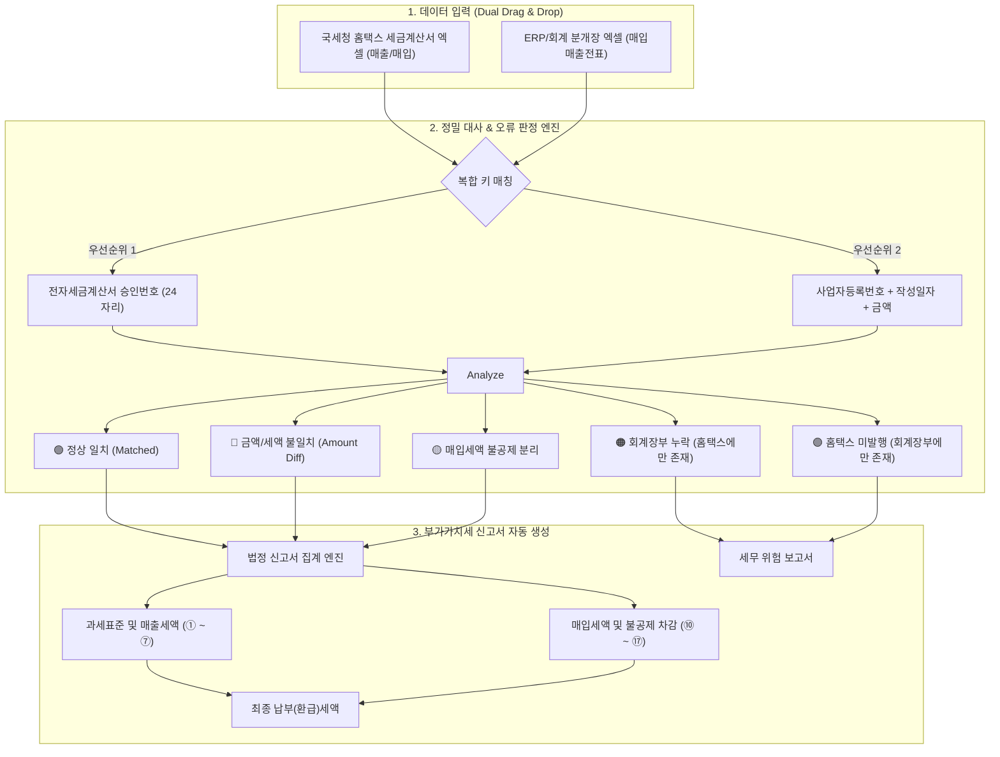

# 📊 국세청 세금계산서 vs 회계장부 대사 분석 & 부가세 신고서 자동작성 시스템 설계서 (v2.0)

## 1. 시스템 목표
1. **양방향 데이터 대사(Reconciliation)**:
   - 국세청 홈택스 전자세금계산서(매출/매입) 데이터와 ERP/회계 프로그램(더존, 위하고, 세무사랑, 이카운트 등)의 분개장을 자동 비교분석.
2. **세무 위험(오류) 자동 감지**:
   - 금액/세액 불일치 (1원 단수차이, 타이핑 오류).
   - 국세청 발행 누락 (회계장부에는 있으나 홈택스 미발행 $\rightarrow$ 매입세액 불공제/가산세 위험).
   - 회계전표 누락 (홈택스에는 있으나 장부 미반영 $\rightarrow$ 신고 누락 위험).
   - 매입세액 불공제 항목 분리 (비영업용 소형승용차, 접대비 등).
3. **법정 부가가치세 신고서 표준 서식 자동 집계**:
   - 대사 완료된 검증 데이터를 바탕으로 대한민국 국세청 **부가가치세 (확정/예정) 신고서 표준 서식**을 자동 작성하고 최종 납부(환급)세액 산출.

---

## 2. 데이터 대사 및 분석 아키텍처

---

## 3. 대사 오류 판정 세부 기준

| 판정 구분 | 발생 원인 | 세무 리스크 | 시스템 처리 방식 |
| :--- | :--- | :--- | :--- |
| **정상 일치 (Match)** | 사업자번호, 일자, 공급가액, 세액 100% 일치 | 없음 | 신고서 정상 반영 |
| **단수 차이 (Penny Diff)** | 1원의 단수 계산 방식 차이 | 경미 | 국세청 기준 자동 조정 |
| **금액 불일치 (Mismatch)** | 전표 타이핑 오차, 공급대가/공급가액 혼동 | 과소/과다 신고 가산세 | 차액 및 차이 필드 붉은색 강조 |
| **회계 누락 (Hometax Only)** | 홈택스 발행 세금계산서의 장부 전표 미입력 | 매입 누락(세금 과다) or 매출 누락(가산세) | 전표 추가 입력 권고 리스트 추출 |
| **홈택스 누락 (ERP Only)** | 세금계산서 미수취, 거래처 미발행 | 가공거래 의심, 매입세액 전액 불공제 | 미발행 거래처 확인 알림 및 분리 |
| **매입세액 불공제** | 비영업용 소형차, 접대비, 면세사업 관련 지출 | 매입세액 부당 공제 시 10%~40% 가산세 | 세액 계산 후 ⑯번 '공제받지 못할 매입세액'으로 자동 차감 |

---

## 4. 국세청 부가가치세 신고서 집계 매핑 표준

### [매출세액 (과세표준)]
- **① 과세 세금계산서 발급분**: 홈택스 정상 대사 완료된 일반과세 매출
- **⑤ 영세율 세금계산서 발급분**: 영세율 적용 매출
- **⑦ 매출세액 합계**: $\sum(\text{공급가액} \times \text{세율})$

### [매입세액]
- **⑩ 일반매입**: 상품, 원재료, 일반 소모품 등 세금계산서 수취분
- **⑪ 고정자산 매입**: 기계장치, 건물, 비품 등 유형자산 매입분
- **⑯ 공제받지 못할 매입세액**: 비영업용 승용차, 접대비 등 불공제 합계 (차감 항목)
- **⑰ 차감 매입세액 합계**: $(\text{⑩} + \text{⑪}) - \text{⑯}$

### [납부세액]
- **최종 납부(환급)세액** = **⑦ 매출세액 합계** $-$ **⑰ 매입세액 합계**
  *(양수면 납부할 세액, 음수면 환급받을 세액)*
